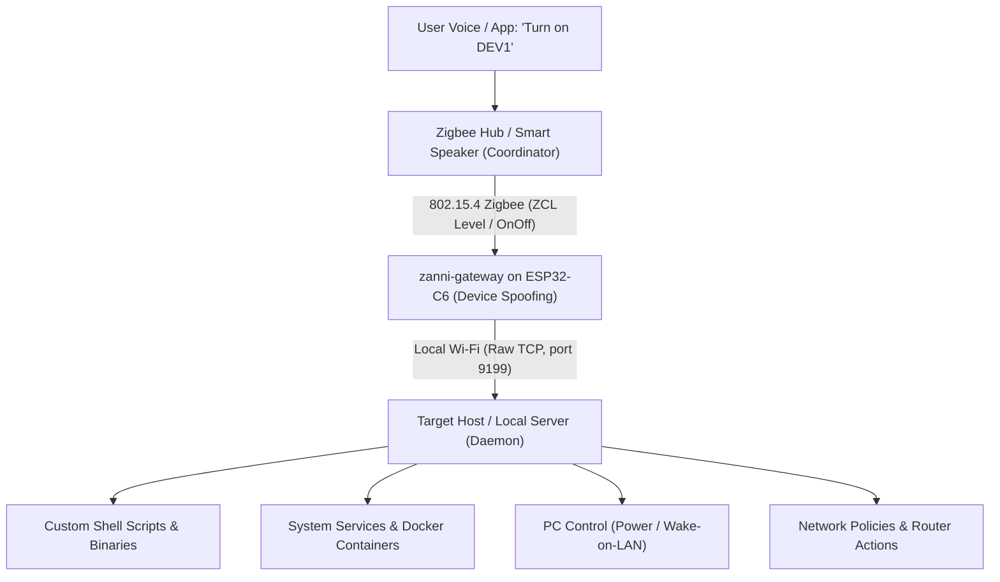

# zanni-gateway

> **Universal Zigbee-to-Wi-Fi Bridge for Arbitrary Virtual Devices on ESP32-C6**

**zanni-gateway** is an embedded firmware project for the ESP32-C6 microcontroller that functions as a secure, completely local hardware bridge between a Zigbee smart home ecosystem (such as SberBoom or other Zigbee coordinators) and your local network hosts (Linux servers, Orange Pi / Raspberry Pi, PCs, routers, and homelab appliances).

It allows you to expose **any number of arbitrary virtual devices (switches, toggles)** to your Zigbee coordinator, mapping them directly to **custom commands, shell scripts, and system actions** on your local network machines—without requiring open inbound ports, port forwarding, or third-party cloud services.

---

## Purpose & Concept

Zigbee smart speakers and hubs make it easy to control physical smart devices (lights, sockets, relays) via voice commands and ecosystem routines. However, integrating custom software actions or non-standard local hardware into these ecosystems usually presents a challenge:

- Traditional integrations require exposing your local network to external cloud webhooks or running complex cloud-based skills.
- Direct network control of local servers, containers, or network gear from a proprietary voice assistant is often unsupported out of the box.

**zanni-gateway solves this by emulating standard Zigbee hardware:**

1. **Virtual Device Mapping:** You define virtual devices in a network map. To your Zigbee hub, zanni-gateway appears as a familiar certified device (such as a dimmable light or relay).
2. **Arbitrary Action Binding:** When you turn on, turn off, or adjust a virtual device (via voice or mobile app), zanni-gateway translates the Zigbee command and sends a lightweight TCP message across your local Wi-Fi network to the target machine.
3. **Execution on Target Host:** A lightweight daemon on the target host receives the message and executes whatever action you have bound to that virtual device.

### What You Can Control

Because any action can be bound to a virtual device state, possibilities are limitless:

- **System & Service Management:** Start, stop, or restart `systemd` services, Docker containers, or virtual machines.
- **Homelab & Media Automation:** Trigger backup jobs, wake up machines via Wake-on-LAN, power down a PC, or launch media scripts.
- **Network Administration:** Toggle VPN tunnels (WireGuard, OpenVPN), switch proxy backends, reload firewall rules (`nftables`/`iptables`), or reboot a router interface.
- **Custom Hardware & Scripts:** Trigger custom GPIO scripts, Serial/I2C relays, or any user-defined shell command.

**All communication remains strictly inside your local area network (LAN). The inbound network perimeter stays closed to the outside world.**

---

## Architecture & Data Flow



### Flow of Execution

1. **User Command:** The user toggles a device in their smart home app or gives a voice command (e.g., *"Salute, turn on Dev 1"*).
2. **Zigbee Transmission:** The coordinator sends a standard Zigbee Cluster Library (ZCL) command (On/Off or Level Control) to zanni-gateway over IEEE 802.15.4.
3. **Command Decoding & Translation:** In `zigbee_zboss_task`, zanni-gateway identifies the target virtual device tag and desired state. In multi-device setups using Level Control, brightness percentage ranges represent discrete virtual switches.
4. **Non-Blocking Forwarding:** The command is pushed into internal FreeRTOS queues (`net_queue`, `zb_state_queue`, `status_queue`), preventing delays in the Zigbee event loop.
5. **TCP Dispatch:** The `wifi_task` receives the message and transmits it over a persistent TCP socket to the target host and port configured in the network map.
6. **State Synchronization:** When the host responds, the result is relayed back to `zigbee_state_task` to update local device state records and report the confirmed state back to the Zigbee coordinator.

---

## Key Features

- **Arbitrary Virtual Device Abstraction:** Map any number of virtual toggles to distinct network hosts and arbitrary commands.
- **RF Coexistence (Wi-Fi + 802.15.4):** Leverages ESP-IDF hardware/software radio coexistence on a single 2.4 GHz antenna, seamlessly sharing airtime between Wi-Fi and Zigbee without packet loss.
- **Zigbee Device Spoofing:** Emulates manufacturer and model attributes of certified devices (e.g., Tuya `TS0505B` / `_TZ3210_b3kiq1i0` or Sonoff) to pass strict interview routines on closed commercial hubs.
- **Virtual Device Multiplexing:** Translates discrete Level Control (brightness) ranges or distinct endpoints into multiple independent virtual switches.
- **Real-Time Visual Diagnostics:** Onboard WS2812 RGB LED provides immediate status feedback (Pairing/Config, Online, RX/TX activity, Fault).
- **Configurable Network Map:** Static network topology generated from simple YAML configurations via `tools/netmap-generator`.

---

## Hardware Overview

The project is designed for boards based on the **ESP32-C6** SoC (such as the *ESP32-C6 SuperMini*):

- **SoC:** ESP32-C6 (32-bit RISC-V core up to 160 MHz).
- **Radios:** 2.4 GHz Wi-Fi 6 (802.11ax/b/g/n) and 802.15.4 (Zigbee 3.0).
- **Status LED:** Onboard WS2812 addressable RGB LED connected to GPIO 8 (driven via ESP32 RMT peripheral).
- **Antenna:** External antenna via IPEX / U.FL connector recommended for reliable reception inside metal enclosures or server racks.

---

## Building and Flashing

### Requirements
- **ESP-IDF v5.1+** (with ESP32-C6 support)
- Python 3.10+

### Steps

#### 1. Generate Network Map (Optional / If modifying topology)
The network map associates virtual switch tags with destination host IPs, ports, and device types:
```bash
# Using Python directly:
python tools/netmap-generator/netmap-generator.py -i tools/netmap-generator/netmap-input.example.yaml -o components/common/include/netmap.h

# Or via Makefile:
make gen-netmap NETMAP_INPUT=tools/netmap-generator/netmap-input.example.yaml
```

#### 2. Set Target Chip
```bash
idf.py set-target esp32c6
```

#### 3. Build the Project
Configure Wi-Fi credentials and optional build flags directly from the build command:
```bash
idf.py -D WIFI_SSID="my-wifi" -D WIFI_PASS="12345" -D IS_MONITOR_TASK_ENABLED=0 build
```

##### Build Options Explained

| Option | Type | Description |
|---|---|---|
| `-D WIFI_SSID="<ssid>"` | **Required** | The SSID of your 2.4 GHz Wi-Fi network that the ESP32-C6 will connect to in Station (STA) mode. |
| `-D WIFI_PASS="<password>"` | **Required** | The WPA2/WPA3 password for the Wi-Fi network. |
| `-D IS_MONITOR_TASK_ENABLED=<0\|1>` | **Optional** | Set to `1` to compile and launch the diagnostic `monitor_task`. When enabled, it logs CPU frequency, free heap space, minimum free heap watermark, and runtime FreeRTOS task stats every 5 seconds. Default is `0` (disabled to conserve RAM and reduce serial logging). |

#### 4. Flash and Monitor
```bash
idf.py -p <PORT> flash monitor
```

*(Press `Ctrl+]` to exit the serial monitor).*

---

## License

This project is licensed under the MIT License. See the [LICENSE](LICENSE) file for details.
